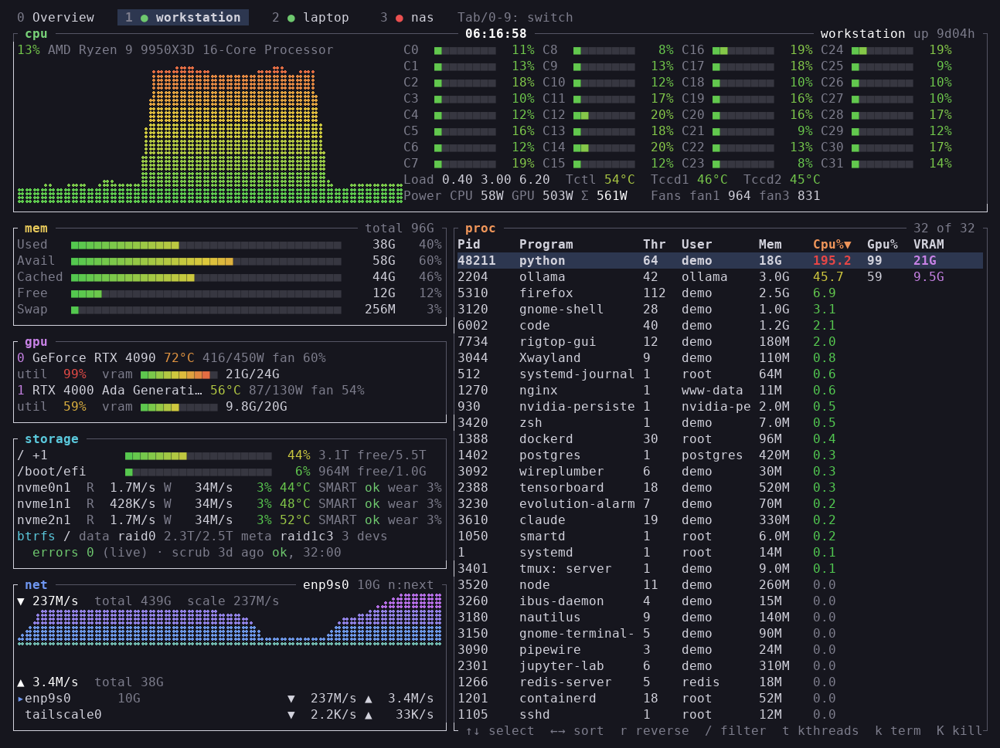
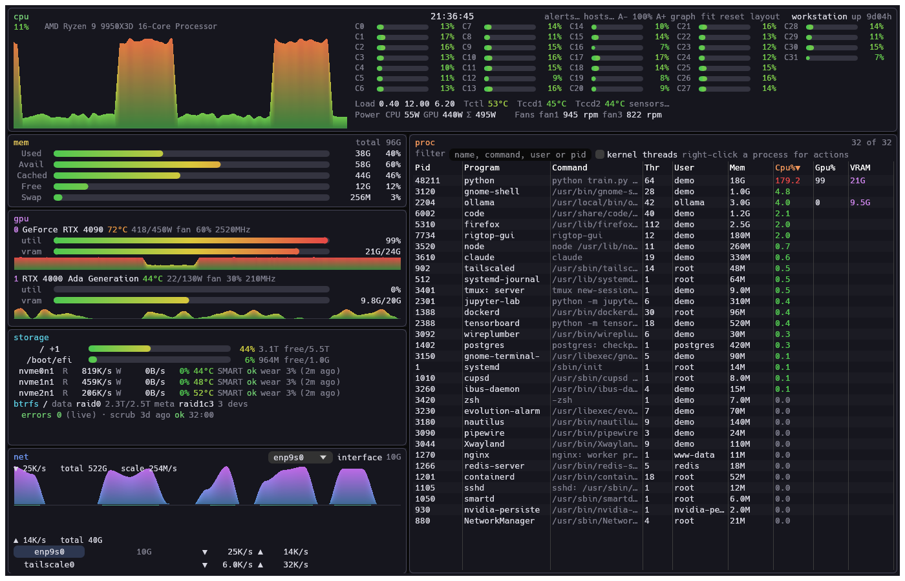
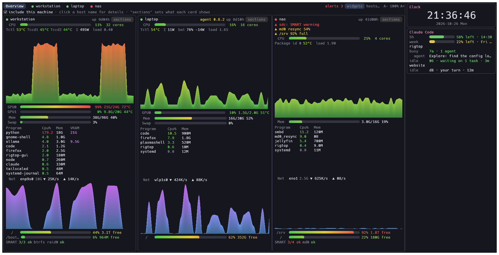
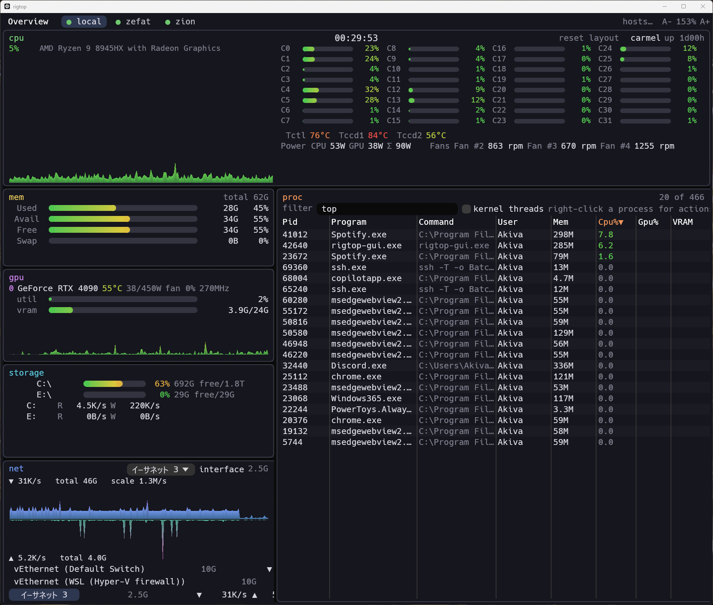

# rigtop


[](https://crates.io/crates/rigtop) [](https://github.com/akivajp/rigtop/actions/workflows/ci.yml)

> **開発の初期段階です。** TUI と GUI は Linux と Windows で動き、SSH で複数のホストをオーバービューでまとめて監視できます。

ワークステーション・ノート PC・NAS 向けのシステムモニターです。btop の代わりに使え、ストレージの健康状態、プロセスごとの GPU 使用量、SSH 越しの複数ホストまで見られます。収集部分を共通にして、2つの画面を用意しています。

- **`rigtop`** — ターミナル UI（TUI）
- **`rigtop-gui`** — ネイティブ GUI（WebView 不使用）。btop 風の配置で、各パネルをリサイズできる

[English README](README.md)



## 目標

- btop と同じ一覧性: CPU（全体・コアごと・温度）、全 GPU、メモリ、ストレージ、ネットワーク、プロセス一覧（kill / 強制 kill）を1画面に。
- 既存のモニターが手薄な**ストレージの健康状態**: btrfs の RAID 構成とデバイスごとのエラー回数、mdadm の状態、ZFS のプールの健全性、NVMe の温度、SMART。
- プロセスごとの GPU 使用率と VRAM（NVIDIA、NVML 経由）、ディスク I/O。
- CPU + GPU の消費電力の合計、ファン回転数（各系統に任意の名前を付けられる）。
- **SSH だけで複数ホストを監視**: `rigtop --agent` が標準入出力で計測値を流すので、常駐プロセスもポート開放も不要。

## ロードマップ

1. ~~収集部分と TUI（Linux）~~（v0.1）
2. ~~ネイティブ GUI（Linux）~~（v0.1）
3. ~~Windows 対応~~（v0.1。温度・ファン・CPU 電力は v0.4 から LibreHardwareMonitor 経由。macOS は v0.11 から Apple Silicon の実機での確認あり（利用者による））
4. ~~SSH による遠隔監視~~: ホスト1台（v0.2）、複数ホストのオーバービュー（v0.3）

## インストール

Linux（x86_64・aarch64、glibc 2.35 以降）と macOS（Apple Silicon）では、インストールスクリプトで `~/.local/bin` に入れられます（`sudo` は不要）。もう一度実行すると更新できます。

```sh
curl -fsSL https://github.com/akivajp/rigtop/releases/latest/download/install.sh | sh
```

最新のリリースから環境に合ったアーカイブを選び、`SHA256SUMS` と照合してから入れます。オプション（別の版、別の置き場所、端末 UI のみ）は `sh` の後ろに `-s -- --help` を付けると表示されます。先にスクリプトの中身を確認するなら:

```sh
curl -fsSLO https://github.com/akivajp/rigtop/releases/latest/download/install.sh
less install.sh && sh install.sh
```

**更新**: rigtop は起動時と1時間ごとに、github.com で新しいリリースが出ていないかを確かめます（最新のリリースがどれかを問い合わせるだけで、手元の情報は送りません）。新しい版があると見出しに表示し（TUI は `U`、GUI はボタン。GUI は Linux と macOS ではデスクトップ通知も出します）、動いている rigtop をその版に入れ替えられます。新しい版は再起動の後に動きます（GUI には再起動のボタンがあります）。`cargo install` やパッケージマネージャーで入れたものは書き換えず、更新のコマンドを案内します。Windows では rigtop を終了してから `scoop update rigtop` を実行するか、新しい zip で入れ替えてください。[設定](#設定)の `[updates]` で、間隔を変えたり、確認（`check = false`）や通知（`notify = false`）を止めたりできます。

または、[Releases](https://github.com/akivajp/rigtop/releases) のページから環境に合ったアーカイブを取得し、中のバイナリを `PATH` の通った場所に置いてください。

| アーカイブ | 中身 |
|---|---|
| `x86_64-unknown-linux-gnu` | `rigtop`、`rigtop-gui`（glibc 2.35 以降） |
| `aarch64-unknown-linux-gnu` | `rigtop` |
| `x86_64-pc-windows-msvc` | `rigtop.exe`、`rigtop-gui.exe` |
| `aarch64-apple-darwin` | `rigtop`、`rigtop-gui`（署名なし） |

チェックサムは `SHA256SUMS` にあります。Rust の環境（1.95 以降）があれば、[crates.io](https://crates.io/crates/rigtop) から入れることもできます。

```sh
cargo install rigtop rigtop-gui
```

Debian と Ubuntu（22.04 以降）向けには、Releases のページに `.deb` パッケージもあります（`amd64` は GUI とメニュー項目付き、`arm64` は端末 UI のみ）。

```sh
sudo apt install ./rigtop_*_amd64.deb
```

Windows では [Scoop](https://scoop.sh) でも入れられます（スタートメニューに rigtop-gui が登録され、`scoop update rigtop` で更新できます）。

```powershell
scoop install https://raw.githubusercontent.com/akivajp/rigtop/main/packaging/scoop/rigtop.json
```

Arch Linux とその派生では、[`packaging/aur/rigtop/PKGBUILD`](packaging/aur/rigtop/PKGBUILD) でパッケージを作れます（AUR のアカウント登録が再開したら、AUR にも登録する予定です）。

```sh
git clone https://github.com/akivajp/rigtop.git
cd rigtop/packaging/aur/rigtop && makepkg -si
```

### アンインストール

| 入れ方 | 削除の方法 |
|---|---|
| インストールスクリプト | `rm ~/.local/bin/rigtop ~/.local/bin/rigtop-gui` |
| `.deb` | `sudo apt remove rigtop` |
| Scoop | `scoop uninstall rigtop` |
| `cargo install` | `cargo uninstall rigtop rigtop-gui` |
| PKGBUILD | `sudo pacman -R rigtop` |
| アーカイブ | 展開したファイルを削除 |

設定していれば、[SMART の収集](#smart-と-btrfs-の-scrub-結果任意)は `sudo rigtop --uninstall-collector` で、集めたファイルごと削除できます。[CPU 電力](#cpu-の消費電力rapl)の udev ルールは `/etc/udev/rules.d/90-rigtop-rapl.rules` です。設定は `~/.config/rigtop/`（Windows は `%APPDATA%\rigtop\`）に、GUI のウィンドウの配置は `~/.local/share/rigtop/`（macOS は `~/Library/Application Support/rigtop/`、Windows は `%APPDATA%\rigtop\data\`）にあります。GUI から LibreHardwareMonitor を入れた場合は `winget uninstall LibreHardwareMonitor.LibreHardwareMonitor` で削除できます。

## 使い方

```sh
cargo run --release -p rigtop            # ターミナル UI
cargo run --release -p rigtop -- --help  # オプション（--interval-ms、--config、--dump-json）
```

`--demo`（TUI・GUI 共通）を付けると、代わりに3台分の架空のデータを表示します。操作を試すのに使えます（このページのスクリーンショットもこれで撮っています）。

| キー | 動作 |
|---|---|
| `↑` `↓` `PgUp` `PgDn` `Home` `End` | プロセスを選ぶ |
| `←` `→` / `r` | 並べ替えの列を変える / 逆順にする |
| `/` | 名前・コマンド・ユーザー・pid で絞り込む（`Enter` で確定、`Esc` で解除） |
| `e` | ツリー表示: プロセスを親の下に並べる（兄弟どうしは並べ替えの順。絞り込み中は見つかったプロセスの親も出す） |
| `t` | カーネルスレッドの表示を切り替える |
| `k` / `K` | 選んだプロセスに SIGTERM / SIGKILL を送る（送る前に確認する） |
| `n` | 表示するネットワークインターフェースを切り替える |
| `+` / `-` | 更新間隔を長く / 短くする |
| `U` | 見出しに新しいリリースが出ているとき、手元の rigtop をその版に更新する（実行前に確認。再起動の後に有効） |
| `u` | 遠隔ホストの rigtop が手元より古いとき、手元と同じ版に更新する（実行前に確認） |
| `a` | 警告の履歴: rigtop の起動後に全ホストで出た警告と、その解消（`↑` `↓` でスクロール、`a` か `Esc` で閉じる）。新しい警告の件数はタブの行に、ホスト1台なら CPU 欄の見出しに出る |
| `g` | グラフの時間幅: 幅に合わせる（1点 1サンプル）か、直近の 1・5・15 分・1・6・24 時間（1時間を超える分は1分ごとの平均から） |
| `q` | 終了 |
| マウス | プロセスをクリックで選択、列の見出しをクリックで並べ替え（もう一度で逆順）、ホイールでスクロール |

### GUI



```sh
cargo run --release -p rigtop-gui            # オプションは TUI と同じ（--interval-ms、--config）
```

パネルの境界をドラッグでリサイズ、パネルの見出しをドラッグで並べ替えできます。列の見出しクリックで並べ替え、「tree」にチェックでツリー表示、プロセスを右クリックで終了・強制終了（送る前に確認）、ネットワークのインターフェースは一覧から選べます。

文字の大きさは Ctrl + マウスホイール、Ctrl + `+` / `-` / `0`、または CPU パネルの見出しにある `A-` / `A+` ボタンで変えられます。拡大率とパネルの配置は次回起動時に復元されます。「reset layout」で初期配置に戻せます。同じ見出しの「graph」ボタンでグラフの時間幅（幅に合わせる・直近の 1・5・15 分・1・6・24 時間）を切り替えられ、これも次回に復元されます。「alerts…」では、起動してから全ホストで出た警告と消えた警告を時刻付きで一覧できます。まだ見ていない警告があると、その数を警告の色で表示します。CPU のコアの下の「sensors…」（またはセンサー名のクリック）で、全ての温度・ファンを一覧するウィンドウが開き、名前を付けたり非表示にしたりできます。[設定](#設定)ファイルの `[sensors]` に保存されます。

いずれかのホストに新しい警告（ドライブのエラー、RAID のデバイスの欠落、SMART の異常、残り容量の少ないファイルシステム、失敗した systemd のサービス）が出ると、GUI はデスクトップ通知を出します（最小化中も。Linux と macOS のみで、Windows は未対応）。起動時から出ている警告は通知しません。[設定](#設定)の `[notifications] level` で、`"critical"`（既定）、`"warning"`（RAID の再同期・容量の逼迫・CPU・GPU・ドライブの高温も含む）、`"off"` を選べます。しきい値は `[alerts]` で変えられます。`rigtop-gui --test-notification` で通知の見本を出せます。

マウス操作が有効なため、多くの端末では Shift+ドラッグで文字を選択できます。

## ウィジェット

同じ画面で一緒に見たいものは、右端のウィジェットの列に並べられます。オーバービューでもホストの詳細表示でも出ます（TUI は端末の幅が120桁以上のとき。`w` で表示・非表示を切り替え）。ウィジェットは組み込みの時計か任意のコマンドで、コマンドは表示している機械で数秒ごとに実行します。

```toml
[[widgets]]
name = "Clock"
builtin = "clock"

[[widgets]]
name = "Rates"
command = "~/bin/rates.sh"   # sh -c で実行（Windows は cmd /C）
interval_secs = 60           # 既定 5
timeout_secs = 10            # 既定 10
```

コマンドは、テキスト（1行が1行）か、次の形の JSON を出力します。どの項目も省略できます。

```json
{"rows": [
  {"label": "5h", "value": "42% · resets 14:30", "gauge": 0.42, "level": "ok"},
  {"value": "rigtop", "heading": true},
  {"label": "busy", "value": "2 subagents", "level": "warn"}
]}
```

`gauge` は割合（0〜1）でバーとして描きます（長さに沿って緑から赤へ。残量のように満タンが良いものは `"gauge_style": "level"` で行の色1色）。`level` は `normal`・`dim`・`ok`・`warn`・`bad` のいずれかです。実行に失敗したときは、前回の内容を残したまま、コマンドの stderr の最後の行を表示します。

例: [`contrib/widgets/claude-code/`](contrib/widgets/claude-code/) は、Claude Code の利用枠・稼働中のセッション・サブエージェントを表示します。

## SSH による遠隔監視

監視される側にも rigtop を入れたうえで、設定ファイルかコマンドラインでホストを指定します。

```toml
# ~/.config/rigtop/config.toml
[[hosts]]
name = "zefat"                 # ssh を省略すると、これが接続先にもなる

[[hosts]]
name = "nas"
ssh = "admin@nas.local"
command = "/usr/local/bin/rigtop --agent"
sections = ["storage", "cpu", "network"]   # このホストのオーバービューで先に出す項目
```

```sh
rigtop                          # TUI: 設定ファイルのホストを表示
rigtop-gui --host hermon        # GUI: コマンドラインのホストも追加（複数指定可）
```

GUI では **hosts…**（タブの並び、または手元の機だけを表示しているときは CPU パネルの見出し）から、ホストの追加・編集・削除と接続テストができます。変更は設定ファイルの `[[hosts]]` に書き込まれるので、TUI にも反映されます。ファイルのそれ以外の部分はそのまま残ります。

ホストが2台以上あると、全ホストを並べた**オーバービュー**から始まります。ホストごと（手元の機を含む）の詳細表示はタブで切り替えます。各ホストのカードには、まず要注意の項目（ストレージのエラー、SMART の異常、RAID の劣化、残り容量の少ないファイルシステム、高温の CPU・GPU・ドライブ）を出し、続けて CPU・GPU・メモリ・プロセス上位・ネットワーク・ストレージを、この順にカードに入る分だけ出します。順番は `[overview] sections`（全体）、ホストごとの `sections`、GUI のカードの「sections」メニューで変えられます。手元の機のカードを出すかどうかは `[overview] include_local`（GUI はチェックボックス、TUI は `l` キー）で切り替えます。TUI では `Tab` と `0`〜`9` で、オーバービューと各ホストを切り替えます。



rigtop は OS の `ssh`（Windows では標準の OpenSSH クライアント）で、各ホストの `rigtop --agent` を起動します。`~/.ssh/config`・鍵・`ProxyJump` はいつもどおり使えます。常駐プロセスもポート開放も不要で、エージェントは接続が切れると終了し、rigtop は自動で再接続します。つながらない間は、そのホストのカード・タブ・見出しに、どれくらいの間・いつから途切れているかを出します（`offline for 5m (since 14:03)`）。詳細表示していないホストからは、プロセスの上位だけを受け取ります。

- パスワードを聞かれない認証（鍵や ssh-agent）が必要です。ホスト鍵も登録済みである必要があるので、先に一度 `ssh <ホスト>` で接続してください。
- 非対話の SSH セッション（`ssh ホスト コマンド`）では、`~/.local/bin`（インストールスクリプトの入れ先）や `~/.cargo/bin` に `PATH` が通っていないことがよくあります（zsh は `~/.zshenv` しか読まず、bash は多くの場合何も読みません）。そこで `rigtop` が見つからなければ、rigtop が自動で `~/.local/bin/rigtop --agent`、次に `~/.cargo/bin/rigtop --agent` を試します。それ以外の場所に置いた場合は、ホストの `command`（`--host` なら `--remote-command`）でコマンドを指定してください。
- 遠隔のプロセスの終了は、SSH でログインしたユーザーの権限で行われます。
- 手元と違う版の rigtop が入っているホストは、見出しにその版を出します（`agent 0.8.2`）。新しい項目は、そのホストの rigtop を更新すると表示されます。手元より古い場合は、TUI の `u` か GUI でその表示をクリックすると、手元と同じ版に更新できます。確認の後、SSH 越しにリリースのインストールスクリプトを実行して、エージェントとして動いている rigtop を入れ替え、つなぎ直します（curl か wget のある Linux・macOS のホスト）。`cargo install` やパッケージマネージャーで入れたものは書き換えず、更新のコマンドを案内します。Windows のホストは Scoop で更新してください。

## Linux

ほとんどの項目は、追加のソフトも特別な権限も無しで表示できます（CPU、メモリ、プロセス、温度とファン（hwmon）、ネットワーク、ディスク、btrfs と md の RAID、ノート PC のバッテリー）。次の項目だけ、パッケージか権限が必要です。

| 項目 | 必要なもの | Debian / Ubuntu | Arch / CachyOS |
|---|---|---|---|
| NVIDIA の GPU | ドライバの NVML ライブラリ | NVIDIA のドライバに含まれる | `nvidia-utils` |
| AMD / Intel の GPU | 不要（sysfs から読む）。Intel の使用率は特権が無いと取れない | | |
| Wi-Fi の信号強度と速度 | `iw` | `sudo apt install iw` | `sudo pacman -S iw` |
| SMART | `smartmontools` とタイマー（[下記](#smart-と-btrfs-の-scrub-結果任意)） | `sudo apt install smartmontools` | `sudo pacman -S smartmontools` |
| CPU の消費電力 | RAPL の読み取り権限（下記） | | |

### CPU の消費電力（RAPL）

Linux 5.10 以降、CPU のエネルギー計（`/sys/class/powercap/intel-rapl:*/energy_uj`。AMD でもこの名前）は root しか読めません。細かい消費電力の変化から秘密の情報を推測される恐れがあるためです（[PLATYPUS](https://platypusattack.com/)、CVE-2020-8694）。udev のルールで管理者グループに読み取りを許可できます。`ADMIN_GROUP` は Debian/Ubuntu なら `sudo`、Arch なら `wheel` に置き換えてください。

```sh
echo 'SUBSYSTEM=="powercap", KERNEL=="intel-rapl:*", RUN+="/usr/bin/chgrp ADMIN_GROUP /sys%p/energy_uj", RUN+="/usr/bin/chmod g+r /sys%p/energy_uj"' \
  | sudo tee /etc/udev/rules.d/90-rigtop-rapl.rules
sudo udevadm control --reload && sudo udevadm trigger --subsystem-match=powercap
```

設定しない場合、AMD のノート PC では代わりに APU の SoC 全体の消費電力（`SoC`）を表示し、それ以外の機械では `--` になります。

## Windows

`rigtop` と `rigtop-gui` は Windows でも動きます（[インストール](#インストール)を参照）。最新の `main` をビルドしたものも [CI の実行結果](https://github.com/akivajp/rigtop/actions/workflows/ci.yml) に添付しています（成果物 `rigtop-windows-x86_64`）。

Linux との違い:

- CPU 使用率、メモリ、プロセス、ネットワーク（リンク速度を含む）、ドライブの容量とドライブごとの I/O、NVIDIA の GPU（ドライバ付属の `nvml.dll` 経由）は、追加のソフト無しで表示できます。
- 温度・ファン・CPU の消費電力・ドライブの健康状態（摩耗・予備領域・温度）は、Windows が標準で持たないハードウェアのドライバが必要です。[LibreHardwareMonitor](https://github.com/LibreHardwareMonitor/LibreHardwareMonitor) が動いていればそこから読み取ります（下記）。動いていなければ Windows 自身が出す値だけを表示するので、多くの環境では何も出ません。ドライブはディスクの管理と同じ番号で `disk0`、`disk1`… と表示します。
- ロードアベレージとディスクの使用率（busy %）はありません。
- Windows にはシグナルがありません。「強制終了」（`K`）はプロセスを即座に終了し、「終了」（`k`）はタスクマネージャーの「タスクの終了」と同じくプロセスのウィンドウに閉じる要求を送ります。ウィンドウの無いプロセス（コンソールのプログラムやサービス）では、その旨を表示します。



### LibreHardwareMonitor で温度・ファン・CPU の消費電力を表示する

`rigtop-gui` では、CPU パネルの案内の横にある **set up…** が下の手順 1〜3 を代行します。必要なら winget で LibreHardwareMonitor を導入し、Web サーバーをこの PC からだけ接続できる形（127.0.0.1）で有効にして起動します。手作業で行う場合:

1. CPU のセンサーに要る PawnIO ドライバと一緒に導入します（ドライバの導入で管理者の承認を求められます）。
   ```powershell
   winget install LibreHardwareMonitor.LibreHardwareMonitor
   ```
   （または [リリース](https://github.com/LibreHardwareMonitor/LibreHardwareMonitor/releases) から `LibreHardwareMonitor.zip` を入手し、ファイルのプロパティでブロックを解除してから展開します。）
2. 新しく開いた端末で `LibreHardwareMonitor` を実行し（展開した場合は `LibreHardwareMonitor.exe`）、管理者としての実行を許可します。
3. **Options → Remote Web Server → Run** を有効にします（ポート 8085）。rigtop は `http://127.0.0.1:8085/data.json` を読み、10秒以内に値を表示し始めます。それまでは CPU パネルに案内が出ます。
4. 必要なら **Options → Run On Windows Startup** と **Start Minimized** も有効にします。

Web サーバーは認証無しにしてください。Windows ファイアウォールで塞がない限り、このポートには他の機械からも接続できます。アドレスやポートを変えた場合は[設定](#設定)の `[lhm] url` で指定し、`url = ""` で読み取りを止められます。NVIDIA の GPU は LibreHardwareMonitor ではなく、従来どおりドライバから読みます。

## SMART と btrfs の scrub 結果（任意）

SMART と btrfs の scrub 結果は root しか読めません。rigtop 自身は root で動かさず、デバイスの権限も緩めません。代わりに root の systemd タイマーが10分ごとに集めて `/var/lib/rigtop/` の下に誰でも読めるファイルとして置き、rigtop はそれを読みます。

- `smart/<デバイス名>.json`: 全ドライブの `smartctl -j -a` の結果（スリープ中のディスクは起こさない）
- `btrfs/scrub.status.<fsid>`: btrfs-progs の scrub 状態ファイルの写し。全データを最後に検査した時刻として表示する

```sh
sudo apt install smartmontools   # Arch 系: sudo pacman -S smartmontools
sudo "$(command -v rigtop)" --install-collector
```

`--install-collector` はスクリプトと systemd のユニット（[`contrib/collect/`](contrib/collect/) のファイル）を配置し、タイマーを有効にして、その場で1回収集します。`--uninstall-collector` で、これらと集めたファイルを削除します。`sudo` は通常 `~/.cargo/bin` を探さないので、フルパスで実行してください。リポジトリを clone している場合は、手作業でも同じことができます。

```sh
sudo install -m 755 contrib/collect/rigtop-collect /usr/local/libexec/
sudo install -m 644 contrib/collect/rigtop-collect.service contrib/collect/rigtop-collect.timer /etc/systemd/system/
sudo systemctl daemon-reload
sudo systemctl enable --now rigtop-collect.timer
```

SMART のファイルにはドライブのシリアル番号が含まれます。

## 設定

`~/.config/rigtop/config.toml`（Windows は `%APPDATA%\rigtop\config.toml`）。どの項目も省略できます。rigtop の起動中に書き換えても、1秒ほどで反映されます。`[[hosts]]` に足したホストにはつなぎ、消したホストからは切断します（残ったホストの履歴はそのまま）。ウィジェットは作り直します。ファイルが読めないときは、その旨を表示して今の設定のまま動きます。

```toml
[sensors]
# センサーの各系統の表示名。キーは rigtop が表示する系統のキー
labels = { "nct6686:nct6683.2592/fan1" = "CPU ファン" }
# 隠す系統（未接続で -40 ℃ と出るサーミスタなど）
hidden = ["nct6686:nct6683.2592/temp4"]

[smart]
dir = "/var/lib/rigtop/smart"

[btrfs]
scrub_dir = "/var/lib/rigtop/btrfs"

[alerts]
# 警告にする値（0 でその警告を出さない）
filesystem_warning_percent = 90
filesystem_critical_percent = 97
cpu_warning_celsius = 96    # CPU の最も高い温度
gpu_warning_celsius = 85
drive_warning_celsius = 70  # SMART か NVMe のセンサー
ignored_units = []          # 失敗していても警告しない systemd のユニット（例: ["foo.service"]）

[notifications]
# rigtop-gui: 新しい警告のデスクトップ通知（"critical"・"warning"・"off"）
level = "critical"

[updates]
# github.com で新しいリリースを確かめる（起動時と interval ごと。
# "30m"・"6h"・"1d"・"1h30m" のように書く。最短1分）
check = true
interval = "1h"
notify = true   # rigtop-gui: 新しいリリースのデスクトップ通知

[lhm]
# Windows: LibreHardwareMonitor の Web サーバー（"" で無効）
url = "http://127.0.0.1:8085/data.json"
```

## コード署名ポリシー（Code signing policy）

Windows 版のリリースのコード署名を、[SignPath Foundation](https://signpath.org) に申請しています。承認されるまで、リリースは署名なしです。承認後は次のとおりです: Free code signing provided by [SignPath.io](https://about.signpath.io), certificate by [SignPath Foundation](https://signpath.org).

- **署名するもの**: Windows 版のアーカイブに入る `rigtop.exe` と `rigtop-gui.exe`。このリポジトリのタグのソースから、GitHub Actions（[`release.yml`](.github/workflows/release.yml)）でビルドしたものだけです。他の場所でビルドしたものは署名せず、署名の依頼は毎回手作業で承認します。
- **担当**: 作成（author）・レビュー（reviewer）・承認（approver）とも [Akiva Miura (@akivajp)](https://github.com/akivajp)。他の方からの変更はプルリクエストで受け、レビューしてから取り込みます。

### プライバシー

rigtop は利用状況などの情報を集めません。つなぐ先は次だけです。

- 遠隔監視に指定したホスト（OS の `ssh` を使います）
- この機械の LibreHardwareMonitor（Windows、`[lhm] url`）
- 新しいリリースが出ていないかの確認のための github.com（起動時と1時間ごと）。最新のリリースがどれかを問い合わせるだけで、手元の情報は送りません。[設定](#設定)の `[updates] check = false` で止められます。更新を選んだときは、github.com からリリースをダウンロードします。

ウィジェットは、設定したコマンドを実行します。

## ライセンス

[Apache License 2.0](LICENSE-APACHE) と [MIT License](LICENSE-MIT) のどちらかを選んで利用できます。
