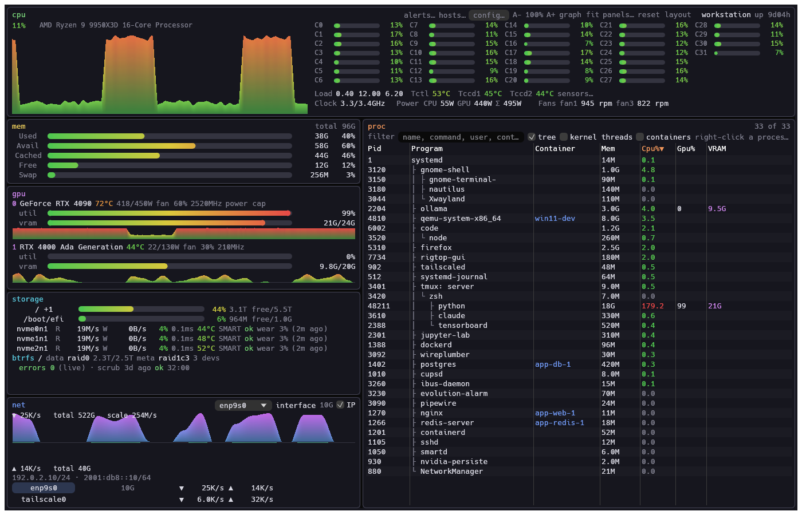
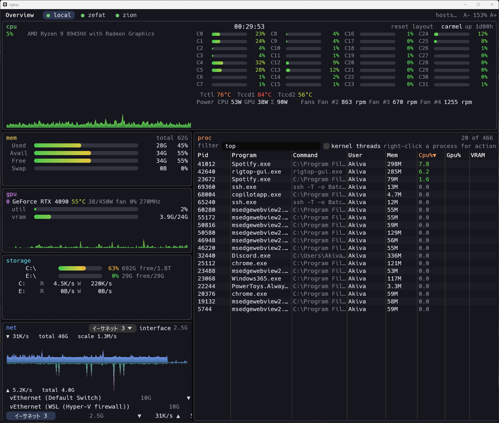

# rigtop


[](https://crates.io/crates/rigtop) [](https://github.com/akivajp/rigtop/actions/workflows/ci.yml)

> **Erken geliştirme aşamasında.** TUI ve GUI, Linux ve Windows üzerinde çalışır ve SSH üzerinden birden fazla ana bilgisayarı genel bakış görünümüyle izler.

İş istasyonları, dizüstü bilgisayarlar ve NAS sistemleri için bir sistem izleyicisi — depolama sağlığını, işlem başına GPU kullanımını ve SSH üzerinden birçok ana bilgisayarı da gösteren bir btop alternatifi. İki ön yüz aynı veri toplama çekirdeğini paylaşır:

- **`rigtop`** — terminal arayüzü (TUI)
- **`rigtop-gui`** — btop benzeri düzen ve yeniden boyutlandırılabilir panellere sahip yerel GUI (web view içermez)

[English README](README.md) | [日本語版 README](README.ja.md)


## Hedefler

- Tek ekranda btop genel bakışı: CPU (toplam, çekirdek başına, sıcaklıklar, saat hızı), tüm GPU'lar, bellek, depolama, ağ ve sonlandırma (`kill` / `force kill`) özellikli işlem listesi.
- Mevcut izleyicilerin çoğunlukla atladığı **depolama sağlığı**: mdadm dizi durumu ve yeniden senkronizasyon ilerlemesi, ZFS havuzları (`raidz` veya `mirror` gibi düzenler, her aygıtın durumu ve okuma, yazma, sağlama toplamı hataları, son scrub, veri hataları), btrfs RAID profilleri ve aygıt başına hata sayaçları, NVMe sıcaklıkları ve SMART sağlığı. ZFS ayrıntıları çoğu sistemde root gerektirmeyen `zpool status` komutundan alınır. ZFS'in okuma önbelleği olan ARC, bellek panelinde kendi satırında gösterilir ve belleği geri verebildiği ölçüde kullanılmış değil kullanılabilir olarak sayılır; böylece bir ZFS ana bilgisayarı belleği tükenmiş gibi görünmez.
- İşlem başına GPU kullanımı ve VRAM (NVML üzerinden NVIDIA; Linux'ta sürücüden kendi işlemleriniz için AMD ve Intel), en yoğun motor sayılır, bu nedenle bir video dönüştürme işi video kodlayıcı kullanımını gösterir; işlem başına disk G/Ç'si ve her işlemin içinde çalıştığı konteyner veya sanal makine (Docker, Podman, Kubernetes, LXC, systemd-nspawn, libvirt, Proxmox VE; Linux).
- Birleşik CPU + GPU güç tüketimi, fan hızları (fan kanalları için kendi etiketlerinizle) ve [Network UPS Tools](#ups-network-ups-tools) üzerinden UPS'ler.
- **Düz SSH üzerinden birden fazla ana bilgisayar**: `rigtop --agent` anlık görüntüleri stdin/stdout üzerinden aktarır, bu nedenle çalıştırılacak bir arka plan servisi veya açılacak bir port yoktur.


## Yol Haritası

1. ~~Linux'ta toplama çekirdeği ve TUI~~ (v0.1)
2. ~~Linux'ta yerel GUI~~ (v0.1)
3. ~~Windows desteği~~ (v0.1; v0.4'ten beri LibreHardwareMonitor üzerinden sıcaklıklar, fanlar ve CPU gücü; v0.11'den beri Apple Silicon üzerinde macOS bir kullanıcı tarafından test edildi)
4. ~~SSH üzerinden uzaktan izleme~~: tek ana bilgisayar (v0.2), genel bakış ile birden fazla ana bilgisayar (v0.3)

## Kurulum

Linux (x86_64 ve aarch64, glibc 2.35 veya üzeri) ve macOS (Apple Silicon) üzerinde kurulum betiği ikili dosyaları `~/.local/bin` dizinine yerleştirir (`sudo` gerekmez). Güncellemek için tekrar çalıştırın:

```sh
curl -fsSL https://github.com/akivajp/rigtop/releases/latest/download/install.sh | sh
```

Betik en son sürümden makineniz için uygun arşivi seçer ve `SHA256SUMS` ile doğrular. Seçenekler için (başka bir sürüm, başka bir dizin, yalnızca terminal arayüzü) `sh` sonrasına `-s -- --help` ekleyin. Önce betiği okumak için:

```sh
curl -fsSLO https://github.com/akivajp/rigtop/releases/latest/download/install.sh
less install.sh && sh install.sh
```

Windows 11'de önerilen yöntem Store uygulamasından veya bir terminalde winget ile [Microsoft Store](https://apps.microsoft.com/detail/9n6jmv1qndck)'dur (winget'in `msstore` kaynağı üzerinden aynı paket; kimliği `9N6JMV1QNDCK`):

```powershell
winget install rigtop
```

Paket imzalıdır (SmartScreen uyarısı vermez) ve Store tarafından güncel tutulur. Başlat menüsüne rigtop'u (GUI) ekler ve terminal sürümünü `PATH` üzerine `rigtop` olarak koyar. Store kopyasında farklı olanlar:

- Ayarlar ve uyarı geçmişi paketin kendi klasöründe, `%LOCALAPPDATA%\Packages\C2B504BA.rigtop_1raghr5p0ryyw\LocalState` konumundadır (GUI'deki "config…" ve `rigtop --edit-config` buradaki dosyayı açar); kaldırma işlemi bu klasörü siler.
- Yeni sürümleri kendisi aramaz veya güncellemez; bunu Store yapar.
- "set up…" seçeneği [LibreHardwareMonitor](#librehardwaremonitor-ile-sıcaklık-fan-ve-cpu-gücü)'ü kurmak yerine nasıl yapılandırılacağını açıklar (Store uygulamaları sürücü getiren başka yazılımlar kuramaz).
- `rigtop-gui` komutu yoktur (bir Store paketinin tek komutu vardır): GUI'yi Başlat menüsünden başlatın; `rigtop` ise `rigtop --demo` gibi seçenekleri alır.

Aşağıdaki Scoop ve zip seçenekleri de Windows'ta, Microsoft Store'un kapalı olduğu ortamlarda bile çalışır.

**Güncellemeler**: rigtop başlangıçta ve her saat başı github.com üzerinde yeni bir sürüm olup olmadığını kontrol eder (yalnızca en son sürümün hangisi olduğunu sorar; makinenizle ilgili hiçbir veri gönderilmez). Yeni bir sürüm olduğunda başlık bunu bildirir (TUI'de `U`, GUI'de Linux ve macOS'ta masaüstü bildirimi de gösteren bir düğme) ve çalışan programın yerine kurulum yapmayı teklif eder; yeni sürüm yeniden başlatmanın ardından çalışır (GUI'de yeniden başlatma düğmesi vardır). `cargo install` veya bir paket yöneticisinden kurulan kopyalara dokunulmaz, yalnızca güncelleme komutu gösterilir; Windows'ta rigtop'tan çıkıp `scoop update rigtop` çalıştırın veya yeni zip ile değiştirin (Microsoft Store kopyasını kendisi günceller). [Yapılandırma](#yapılandırma) içindeki `[updates]` bölümü aralığı değiştirir veya kontrolü (`check = false`) ya da bildirimi (`notify = false`) kapatır.

Alternatif olarak [Releases](https://github.com/akivajp/rigtop/releases) sayfasından platformunuza uygun arşivi indirip ikili dosyaları `PATH` dizininize koyabilirsiniz:

| Arşiv | İçerik |
|---|---|
| `x86_64-unknown-linux-gnu` | `rigtop`, `rigtop-gui` (glibc 2.35 veya üzeri) |
| `aarch64-unknown-linux-gnu` | `rigtop` |
| `x86_64-pc-windows-msvc` | `rigtop.exe`, `rigtop-gui.exe` |
| `aarch64-pc-windows-msvc` | `rigtop.exe`, `rigtop-gui.exe` (Windows on Arm) |
| `aarch64-apple-darwin` | `rigtop`, `rigtop-gui` (imzasız) |

`SHA256SUMS` sağlama toplamlarını listeler. Bir Rust araç zinciri (1.95 veya üzeri) ile [crates.io](https://crates.io/crates/rigtop) üzerinden de kurabilirsiniz:

```sh
cargo install rigtop rigtop-gui
```

Debian ve Ubuntu'da (22.04 veya üzeri), Releases sayfasında `.deb` paketleri de bulunur (`amd64` GUI ve menü girdisiyle, `arm64` terminal arayüzüyle):

```sh
sudo apt install ./rigtop_*_amd64.deb
```

Windows'ta Microsoft Store'un (yukarıda) yanı sıra [Scoop](https://scoop.sh) ile [akivajp bucket](https://github.com/akivajp/scoop-bucket) üzerinden kurabilirsiniz; bu ayrıca `rigtop-gui`'yi Başlat menüsüne ekler (`scoop update rigtop` ile güncellenir). rigtop, Scoop'un varsayılan bucket'larında (main, extras) yer almaz; bu nedenle `scoop search rigtop` yalnızca bucket eklendikten sonra bulur:

```powershell
scoop bucket add akivajp https://github.com/akivajp/scoop-bucket
scoop install akivajp/rigtop
```

Daha önce manifest URL'sinden kurduysanız, güncellemelerin gelmeye devam etmesi için README'sinde açıklandığı şekilde bucket'a geçin.

[Homebrew](https://brew.sh) ile (Apple Silicon macOS, Linux) [akivajp/tap](https://github.com/akivajp/homebrew-tap) tap'inden kurabilirsiniz (`brew upgrade rigtop` ile güncellenir):

```sh
brew install akivajp/tap/rigtop
```

Arch Linux ve türevlerinde [`packaging/aur/rigtop/PKGBUILD`](packaging/aur/rigtop/PKGBUILD) bir paket derler (oradaki hesap kaydı yeniden açıldığında AUR'da da yer alacaktır):

```sh
git clone https://github.com/akivajp/rigtop.git
cd rigtop/packaging/aur/rigtop && makepkg -si
```

### Kaldırma

| Kurulum yöntemi | Kaldırma komutu |
|---|---|
| Kurulum betiği | `rm ~/.local/bin/rigtop ~/.local/bin/rigtop-gui` |
| `.deb` | `sudo apt remove rigtop` |
| Microsoft Store veya winget | Ayarlar → Uygulamalar → Yüklü uygulamalar → rigtop → Kaldır veya `winget uninstall rigtop` (ayarları da silinir) |
| Scoop | `scoop uninstall rigtop` |
| Homebrew | `brew uninstall rigtop` |
| `cargo install` | `cargo uninstall rigtop rigtop-gui` |
| PKGBUILD | `sudo pacman -R rigtop` |
| Arşiv | Çıkardığınız dosyaları silin |

Ardından, eğer kurduysanız: `sudo rigtop --uninstall-collector` komutu [SMART toplayıcısını](#smart-ve-btrfs-scrub-sonuçları-isteğe-bağlı) ve dosyalarını kaldırır; [CPU gücü](#cpu-gücü-rapl) için udev kuralı `/etc/udev/rules.d/90-rigtop-rapl.rules` dosyasındadır. Ayarlar `~/.config/rigtop/` (Windows: `%APPDATA%\rigtop\`) konumunda, GUI pencere düzeni ise `~/.local/share/rigtop/` (macOS: `~/Library/Application Support/rigtop/`, Windows: `%APPDATA%\rigtop\data\`) konumunda tutulur; Microsoft Store kopyası her ikisini de kendi paket klasöründe saklar ve Windows kaldırma sırasında bunları da siler. GUI sizin için LibreHardwareMonitor kurduysa: `winget uninstall LibreHardwareMonitor.LibreHardwareMonitor`.

## Kullanım

```sh
cargo run --release -p rigtop            # terminal UI
cargo run --release -p rigtop -- --help  # options (--interval-ms, --config, --dump-json)
```

`--demo` (TUI ve GUI), arayüzü denemek için üç ana bilgisayar adına uydurma veriler gösterir; buradaki ekran görüntüleri bu modu kullanır.

| Tuş | Eylem |
|---|---|
| `↑` `↓` `PgUp` `PgDn` `Home` `End` | bir işlem seç |
| `←` `→` / `r` | sıralama sütununu değiştir / sırayı tersine çevir |
| `/` | ad, komut, kullanıcı, konteyner veya pid ile filtrele (`Enter` korur, `Esc` temizler) |
| `e` | ağaç görünümü: üst işlemlerin altındaki işlemler, kardeşler sıralama düzeninde (filtre, bulduğu işlemlerin üst işlemlerini korur) |
| `t` | çekirdek iş parçacıklarını (kernel threads) göster veya gizle |
| `v` | ana bilgisayar görünümü kutularını göster veya gizle: `m` bellek, `g` GPU, `s` depolama, `n` ağ, `p` işlemler (`[tui] hidden_panels` olarak kaydedilir) ve `w` widget sütunu; diğerleri boş kalan alanı doldurur |
| `Enter` | seçili işlemin ayrıntıları: üst işlemleri, kullanıcısı, konteyneri, başlangıç zamanı, kullanımı ve tam komut satırı (`Enter` veya `Esc` kapatır) |
| `x` | seçili işlem sonlandığında bildir (ör. bir eğitim çalıştırması): uyarı geçmişinde (`a`), durum satırında ve terminal zilinde. Uzak ana bilgisayarlar için rigtop 0.19 veya üzeri gerekir |
| `k` / `K` | seçili işleme SIGTERM / SIGKILL gönder (önce sorar) |
| `p` | seçili işlemi duraklat (SIGSTOP, önce sorar) veya duraklatılmışsa devam ettir (SIGCONT); duraklatılanlar `stopped` olarak işaretlenir (Linux, macOS; uzak ana bilgisayarlar için rigtop 0.22 veya üzeri gerekir) |
| `C` | her konteynerin ne kullandığını (işlemler, CPU, bellek, GPU) işlem tablosunun üzerinde göster; `/` ve adı yazarak işlemlerini listele |
| `]` / `[` | seçili işlemin önceliğini 5 nice adımı düşür / yükselt (yükseltmek root gerektirir; Linux, macOS; uzak ana bilgisayarlar için rigtop 0.22 veya üzeri gerekir) |
| `n` | ağ arayüzünü değiştir |
| `i` | arayüzün adreslerini (ve `[network] public_ip` ile genel adresi) göster veya gizle, ör. ekran görüntüsü almadan önce |
| `+` / `-` | güncellemeleri yavaşlat / hızlandır |
| `U` | başlıkta yeni bir sürüm çıktığı belirtildiğinde bu makinedeki rigtop'u yeni sürüme güncelle (önce sorar; yeniden başlatmadan sonra çalışır) |
| `u` | bu uzak ana bilgisayardaki rigtop daha eski bir sürüm çalıştırıyorsa sizin sürümünüze güncelle (önce sorar) |
| `a` | uyarılar: şu anda her ana bilgisayardaki uyarılar ve görünüp temizlendikçe oturumlar arasında saklanan geçmişleri. `↑` `↓` mevcut bir uyarıyı seçer ve `z` onu 1 saat, 1 gün, temizlenene kadar veya artık erteleme yok şeklinde erteler (her basış bir sonrakine geçer); `PgUp` `PgDn` geçmişi kaydırır; `a` veya `Esc` kapatır. Yenileri sekme çubuğunda veya tek ana bilgisayarda CPU kutusu başlığında sayılır |
| `g` | grafiklerin kapsadığı süre: genişliğe sığdır (nokta başına bir örnek) veya son 1, 5, 15 dakika, 1, 6 ya da 24 saat (bir saatin ötesinde dakikalık ortalamalardan) |
| `?` / `F1` | gösterilen ekranda çalışan tuşları listele (herhangi bir tuş kapatır) |
| `q` | çıkış |
| fare | seçmek için bir işleme tıkla, sıralamak için sütun başlığına tıkla (ters çevirmek için tekrar), kaydırmak için tekerleği kullan |

Fare desteği açıkken çoğu terminal Shift+sürükle ile metin seçer.

### GUI



```sh
cargo run --release -p rigtop-gui            # same options: --interval-ms, --config
```

Yeniden boyutlandırmak için panel kenarlıklarını, yeniden düzenlemek için panel başlıklarını sürükleyin. Sıralamak için bir sütun başlığına tıklayın, işlemleri üst işlemlerinin altında göstermek için "tree" kutucuğunu, her konteynerin kullanımını görmek için "containers" kutucuğunu işaretleyin (işlemlerini listelemek için birine tıklayın), ayrıntıları için bir işleme çift tıklayın (veya sağ tık → "Details…"), duraklatmak veya devam ettirmek, önceliğini değiştirmek, sonlandırmak veya öldürmek (duraklatma ve sonlandırma önce sorar) ya da "Notify when it exits" (masaüstü bildirimi ve uyarı geçmişinde bir girdi; uzak ana bilgisayarlar için rigtop 0.19 veya üzeri gerekir) için sağ tıklayın ve listeden ağ arayüzünü seçin.

Ctrl + fare tekerleği, Ctrl + `+` / `-` / `0` veya CPU paneli başlığındaki `A-` / `A+` düğmeleriyle yakınlaştırın. Yakınlaştırma düzeyi, panel düzeni ve işlem listesinin sıralama, ağaç ve onay kutuları bir sonraki başlangıçta geri yüklenir (işlem listesi ayarları her ana bilgisayar için saklanır); "panels…" her paneli gösterir veya gizler (diğerleri boşluğu doldurur) ve "reset layout" tüm panellerle varsayılan düzeni geri getirir. Yanındaki "graph" düğmesi grafiklerin kapsadığı süreyi ayarlar (genişliğe sığdır veya son 1, 5, 15 dakika, 1, 6 ya da 24 saat) ve bir sonraki başlangıçta da geri yüklenir. "alerts…" her ana bilgisayarın şu anki uyarılarını (her biri için 1 saat, 1 gün, temizlenene kadar erteleme düğmeleriyle) ve oturumlar arasında (`~/.local/state/rigtop/` içinde) saklanan geçmişini listeler; siz bakana kadar yeni uyarıların sayısını kendi renginde gösterir. Ertelenen bir uyarı durum noktalarından, kartlardan ve bildirimlerden (TUI ve `rigtop --watch` dahil, aynı listeyi paylaşırlar) çıkarılır ve erteleme bittiğinde hâlâ devam ediyorsa yeniden duyurulur. CPU çekirdeklerinin altındaki "sensors…" (veya bir sensörün adına tıklamak), tüm sıcaklık ve fanları adlandırmak veya gizlemek için listeleyen bir pencere açar; [yapılandırma](#yapılandırma) dosyasına `[sensors]` bölümünü kaydeder.

Herhangi bir ana bilgisayarda yeni bir uyarı göründüğünde (disk hataları, eksik RAID aygıtı, başarısız SMART, neredeyse dolu dosya sistemi, başarısız systemd servisi), GUI simge durumuna küçültülmüşken bile bir masaüstü bildirimi gösterir (Linux ve macOS; henüz Windows'ta yok). Başlangıçta zaten mevcut olan uyarılar duyurulmaz. [Yapılandırma](#yapılandırma) içindeki `[notifications] level` ayarı `"critical"` (varsayılan), `"warning"` (yeniden senkronizasyonlar, dolan dosya sistemleri, sıcak CPU'lar, GPU'lar ve diskler dahil) veya `"off"` değerlerini alır; eşikler `[alerts]` içindedir; `rigtop-gui --test-notification` örnek bir bildirim gösterir.

## Widget'lar

Aynı ekranda görmek istediğiniz başka her şey, sağdaki widget sütununa, genel bakış ve ana bilgisayar görünümlerinin yanına yerleştirilebilir (TUI'de terminal en az 120 sütun genişliğinde olduğunda). GUI'de "widgets" veya "panels…" ile, TUI'de ise seçimi `[tui] show_widgets` olarak saklayan `w` (veya `v` ardından `w`) ile gizleyip gösterebilirsiniz. Bir widget, yerleşik bir saat veya görüntülendiği makinede birkaç saniyede bir çalıştırılan herhangi bir komuttur:

```toml
[[widgets]]
name = "Clock"
builtin = "clock"

[[widgets]]
name = "Rates"
command = "~/bin/rates.sh"   # run with sh -c (cmd /C on Windows)
interval_secs = 60           # default 5
timeout_secs = 10            # default 10
```

Komut düz metin (satır başına bir satır) veya her alanı isteğe bağlı olan JSON satırları yazdırır:

```json
{"rows": [
  {"label": "5h", "value": "42% · resets 14:30", "gauge": 0.42, "level": "ok"},
  {"value": "rigtop", "heading": true},
  {"label": "busy", "value": "2 subagents", "level": "warn"}
]}
```

`gauge` bir çubuk olarak çizilen orandır (uzunluğu boyunca yeşilden kırmızıya veya kalan miktarlar için `"gauge_style": "level"` ile satırın renginde), `level` ise `normal`, `dim`, `ok`, `warn`, `bad` değerlerinden biridir (değerin veya başlığın rengi); `label_level` etiket için aynıdır (belirtilmezse `dim`). `"separator": true` içeren bir satır çizgi çizer. `hint`, GUI'de imleç satırın üzerine geldiğinde gösterilen ek bilgidir. Bir çalıştırma başarısız olduğunda, widget son satırları korur ve komutun stderr çıktısının son satırını gösterir.

Örnek: [`contrib/widgets/claude-code/`](contrib/widgets/claude-code/) Claude Code'un kullanım sınırlarını, çalışan oturumlarını ve alt ajanlarını gösterir.

## SSH üzerinden uzaktan izleme

rigtop'u uzak ana bilgisayarlara da kurun, ardından bunları yapılandırma dosyasında veya komut satırında listeleyin:

```toml
# ~/.config/rigtop/config.toml
[[hosts]]
name = "zefat"                 # also the ssh destination unless `ssh` is given

[[hosts]]
name = "nas"
ssh = "admin@nas.local"
command = "/usr/local/bin/rigtop --agent"
sections = ["storage", "cpu", "network"]   # what this host's overview card shows first
[hosts.alerts]                 # this host's thresholds, over those of [alerts]
filesystem_warning_percent = 95
drive_warning_celsius = 55
```

```sh
rigtop                          # TUI: hosts from the configuration
rigtop-gui --host hermon        # GUI: plus a host from the command line (repeatable)
```

GUI'de **hosts…** (sekme çubuğunda veya yalnızca bu makine gösterilirken CPU paneli başlığında) ana bilgisayar ekler, düzenler, kaldırır ve önce bağlantıyı test edebilir. Değişiklikler yapılandırma dosyasındaki `[[hosts]]` bölümüne yazılır, böylece TUI de bunları görür; dosyanın geri kalanına dokunulmaz.

Birden fazla ana bilgisayar olduğunda, rigtop her ana bilgisayar için bir kart içeren bir **genel bakış** ve tam ayrıntı görünümü için her ana bilgisayar adına (bu makine dahil) bir sekme ile açılır. Kartlar uyarıları (depolama hataları, başarısız SMART, bozulmuş RAID, neredeyse dolu dosya sistemleri, sıcak CPU'lar, GPU'lar ve diskler) ve ardından kartta yer olduğu ölçüde bu sırayla CPU, GPU, bellek, en yoğun işlemler, ağ ve depolamayı gösterir; kalan boşluk ayrıntılara (CPU modeli, GPU adları, disk G/Ç) ve ardından CPU ile ağ grafiklerine ayrılır. Bir satırdaki kartlar bölüm bölüm hizalanır. İşlem listesi kart genişliğinde bir tablodur: program adları, ardından CPU, bellek ve GPU'lu ana bilgisayarlarda GPU kullanımı ile VRAM; `[overview] process_columns` kartın genişliği yettiği ölçüde gösterilecek sütunları seçer (`"cpu"`, `"memory"`, `"gpu"`, `"vram"` ve ayrıca `"disk"`, `"user"`, `"command"`). Varsayılan sırayı `[overview] sections` ile, ana bilgisayar başına `sections` ile veya GUI'de her kartın "sections" menüsüyle değiştirebilirsiniz. Bu makinenin bir karta sahip olup olmayacağını `[overview] include_local` (veya GUI'deki onay kutusu, TUI'de `l`) belirler. Kartlar yapılandırılan sırayı izler; `[overview] alerts_first = true` (veya GUI'de "alerts first") ile ilgi gerektiren ana bilgisayarlar önce gelir: ulaşılamayanlar veya kritik uyarısı olanlar, ardından uyarısı olanlar, diğerleri ise kendi sıralarında. TUI'de `Tab` ve `0`-`9` genel bakış ile ana bilgisayarlar arasında geçiş yapar.


rigtop her uzak ana bilgisayarda `rigtop --agent` komutunu sisteminizin `ssh` istemcisi üzerinden başlatır (Windows'ta yerleşik OpenSSH istemcisi), bu nedenle `~/.ssh/config`, anahtarlar ve `ProxyJump` her zamanki gibi çalışır. Çalıştırılacak bir arka plan servisi veya açılacak bir port yoktur; bağlantı kapandığında ajan çıkar ve rigtop kendiliğinden yeniden bağlanır. Bir ana bilgisayara ulaşılamadığında kartı, sekmesi ve başlığı ne kadar süredir ve ne zamandan beri çevrimdışı olduğunu bildirir (`offline for 5m (since 14:03)`). Ayrıntılı olarak gösterilmeyen ana bilgisayarlar yalnızca en yoğun işlemlerini gönderir.

- Kimlik doğrulama istem olmadan çalışmalıdır (anahtar veya ajan) ve ana bilgisayar anahtarı zaten biliniyor olmalıdır: önce bir kez `ssh <host>` ile bağlanın.
- Etkileşimli olmayan SSH oturumlarının `PATH` değişkeninde genellikle `~/.local/bin` (kurulum betiğinin rigtop'u koyduğu yer) ve `~/.cargo/bin` bulunmaz (zsh bunlar için yalnızca `~/.zshenv` okur, bash ise genellikle hiçbir şey okumaz). `rigtop` orada bulunamazsa, rigtop kendiliğinden önce `~/.local/bin/rigtop --agent`, ardından `~/.cargo/bin/rigtop --agent` yollarını dener. Diğer konumlar için ana bilgisayarda `command` (veya `--host` için `--remote-command`) ayarlayın.
- Bir Windows ana bilgisayarı, varsayılan kabuk olarak cmd.exe ile OpenSSH sunucusuna (Ayarlar → Sistem → İsteğe bağlı özellikler) ihtiyaç duyar; değiştirilmediyse varsayılan budur. Windows, SSH oturumlarına Microsoft Store ve Scoop'un rigtop'u koyduğu kullanıcı `PATH`'ini değil yalnızca sistem `PATH`'ini verir: `rigtop` orada bulunamazsa, rigtop kendiliğinden önce Store kopyasını (`%LOCALAPPDATA%\Microsoft\WindowsApps\rigtop.exe`), ardından Scoop kopyasını (`%USERPROFILE%\scoop\shims\rigtop.exe`) dener. Store kopyası, o bilgisayarda kimse oturum açmamışken de yanıt verir.
- Uzak bir ana bilgisayarda işlem sonlandırmak SSH kullanıcısının izinlerini kullanır.
- Her uzak ana bilgisayarın başlığı bağlantısının gidiş-dönüş süresini (`12ms`, her 5 saniyede bir ölçülür; 500 ms'den itibaren sarı) gösterir; bu sayede yavaş bir bağlantı veya zorlanan bir ana bilgisayar ayırt edilebilir. Bunun için ana bilgisayarlarda rigtop 0.23 veya üzeri gerekir.
- Sizinkinden farklı bir rigtop sürümüne sahip bir ana bilgisayar bunu başlığında belirtir (`agent 0.8.2`); güncellendiğinde yeni okumalar görünür. Daha eskiyse, TUI'deki `u` veya GUI'de o nota tıklamak onu sizin sürümünüze günceller (TUI genel bakışında `u` veya GUI sekme çubuğunda "update agents (N)…" bu tür tüm ana bilgisayarları tek seferde günceller): onayladığınızda rigtop SSH üzerinden sürümün kurulum betiğini çalıştırır (curl veya wget bulunan Linux ve macOS ana bilgisayarlar) ve ajanın çalıştırdığı rigtop'u değiştirip yeniden bağlanır. `cargo install` veya bir paket yöneticisinden kurulan kopyalara dokunulmaz, güncelleme komutu gösterilir; Windows ana bilgisayarları Microsoft Store veya Scoop üzerinden güncellenir.

## Penceresiz uyarılar (`rigtop --watch`)

`rigtop --watch`, bu makineyi ve yapılandırılmış ana bilgisayarları bir ekran olmadan izler ve bir uyarı ortaya çıktığında veya temizlendiğinde sizin belirlediğiniz bir komutu çalıştırır; böylece hiçbir rigtop açık değilken bile bozulmuş bir RAID, arızalanan bir disk, güç kesintisi veya çevrimdışı olan bir ana bilgisayar size ulaşır. Komut uyarıyı ortam değişkenlerinde alır (`RIGTOP_HOST`, `RIGTOP_SEVERITY`, `RIGTOP_CHANGE` = `raised` / `cleared`, `RIGTOP_ALERT` ve `[critical] nas: md0 (raid1) degraded` gibi `RIGTOP_MESSAGE`), böylece [ntfy](https://ntfy.sh), bir sohbet webhook'u veya e-postaya gönderebilir:

```toml
[watch]
command = 'curl -s -d "$RIGTOP_MESSAGE" https://ntfy.sh/my-topic'
level = "critical"     # or "warning"
offline_after = "3m"   # a host unreachable this long is a critical alert
processes = ["train.py", "rsync"]  # also tell when these exit, on any host
```

`processes`, sonlandığında bildirim verilecek programları ada veya komut satırındaki bir dosyaya göre belirtir (`python3 jobs/train.py` için `train.py`): çalışırken bulunan her biri yazdırılır (`zefat: watching train.py (pid 1234)`) ve çıkışı (`train.py (pid 1234) exited after 3h12m`, `RIGTOP_CHANGE` = `notice`) `level` ne olursa olsun komutu çalıştırır. Uzak ana bilgisayarlar için rigtop 0.21 veya üzeri gerekir.

`rigtop --test-alert` komutu örnek bir uyarı ile bir kez çalıştırır. Değişiklikler zaman damgasıyla yazdırılır ve kendi uyarı geçmişinde tutulur, bu nedenle yeniden başlatma bunları tekrar göndermez; izleme başladığında zaten mevcut olan uyarılar gönderilir. Bunu bir systemd kullanıcı servisi olarak çalıştırmaya devam etmek için:

```ini
# ~/.config/systemd/user/rigtop-watch.service
[Service]
ExecStart=%h/.local/bin/rigtop --watch
Restart=on-failure

[Install]
WantedBy=default.target
```

```sh
systemctl --user enable --now rigtop-watch
loginctl enable-linger "$USER"            # keep it running while logged out
journalctl --user -u rigtop-watch -f      # what it sees and sends
```

Bir servisin SSH ajanı yoktur: uzak ana bilgisayarlar parolasız bir anahtara (veya bir ajanı gösteren `SSH_AUTH_SOCK` değişkenine) ihtiyaç duyar. Bunu yalnızca tek bir makinede çalıştırın, aksi takdirde her biri aynı uyarıları gönderir.

## Linux

Çoğu okuma için ne ek yazılım ne de ayrıcalık gerekir: CPU, bellek, işlemler, sıcaklıklar ve fanlar (hwmon), ağ, diskler, btrfs ve md RAID ile dizüstü bilgisayar pilleri. Yalnızca birkaçı paket veya izin gerektirir:

| Okuma | Gereksinim | Debian / Ubuntu | Arch / CachyOS |
|---|---|---|---|
| NVIDIA GPU'lar | sürücünün NVML kütüphanesi | NVIDIA sürücüsüyle birlikte gelir | `nvidia-utils` |
| AMD / Intel GPU'lar | hiçbir şey (sysfs; kendi kullanıcınızın işlemleri için sürücünün fdinfo'sundan işlem başına kullanım); Intel'in genel kullanımı ayrıcalık olmadan kullanılamaz | | |
| Wi-Fi sinyali ve hızı | `iw` | `sudo apt install iw` | `sudo pacman -S iw` |
| SMART | `smartmontools` ve bir zamanlayıcı ([aşağıda](#smart-ve-btrfs-scrub-sonuçları-isteğe-bağlı)) | `sudo apt install smartmontools` | `sudo pacman -S smartmontools` |
| CPU gücü | RAPL'a okuma erişimi (aşağıda) | | |

### CPU gücü (RAPL)

Linux 5.10'dan beri CPU enerji sayaçları (`/sys/class/powercap/intel-rapl:*/energy_uj`, AMD'de de bu şekilde adlandırılır) yalnızca root tarafından okunabilir, çünkü ayrıntılı güç okumaları sırları sızdırabilir ([PLATYPUS](https://platypusattack.com/), CVE-2020-8694). Bir udev kuralı yönetici grubunuzun bunları okumasına izin verebilir; `ADMIN_GROUP` yerine Debian/Ubuntu'da `sudo` veya Arch'ta `wheel` yazın:

```sh
echo 'SUBSYSTEM=="powercap", KERNEL=="intel-rapl:*", RUN+="/usr/bin/chgrp ADMIN_GROUP /sys%p/energy_uj", RUN+="/usr/bin/chmod g+r /sys%p/energy_uj"' \
  | sudo tee /etc/udev/rules.d/90-rigtop-rapl.rules
sudo udevadm control --reload && sudo udevadm trigger --subsystem-match=powercap
```

Bunun olmadığı durumda AMD dizüstü bilgisayarlar bunun yerine APU'nun SoC gücünü (`SoC`) gösterir, diğer makineler ise `--` gösterir.

## Windows

Hem `rigtop` hem de `rigtop-gui` Windows'ta çalışır (bkz. [Kurulum](#kurulum)). En son `main` dalının derlemeleri de [CI çalıştırmalarına](https://github.com/akivajp/rigtop/actions/workflows/ci.yml) eklenir (`rigtop-windows-x86_64` yapıtı).

Linux'tan farklı olanlar:

- CPU yükü, bellek, işlemler, ağ (bağlantı hızlarıyla), sürücü kapasitesi ve sürücü başına G/Ç ile NVIDIA GPU'lar (sürücüden `nvml.dll` aracılığıyla) ek yazılım olmadan çalışır.
- Sıcaklıklar, fanlar, CPU gücü ve sürücü sağlığı (aşınma, yedek kapasite, sıcaklık) Windows'un birlikte göndermediği donanım sürücülerini gerektirir. rigtop bunları çalışır durumdayken [LibreHardwareMonitor](https://github.com/LibreHardwareMonitor/LibreHardwareMonitor)'den okur (aşağıya bakın); aksi takdirde yalnızca Windows'un kendi bildirdiği değerler gösterilir ki bu da genellikle hiçbir şeydir. Sürücüler Disk Yönetimi'ndeki gibi `disk0`, `disk1`... olarak adlandırılır.
- Yük ortalaması (load average) ve disk meşguliyet yüzdesi yoktur.
- Windows on Arm (Microsoft Store, Scoop ve `aarch64-pc-windows-msvc` zip paketinin yerel derlemeleri vardır): yalnızca GitHub'ın Arm çalıştırıcılarında derlendi ve test edildi, henüz gerçek bir PC'de test edilmedi. Arm PC'lerin GPU'ları gösterilmez (GPU okumaları NVIDIA'nın kütüphanesinden gelir) ve LibreHardwareMonitor'de işlemcileri için az sayıda sensör bulunabilir.
- Windows'ta sinyaller yoktur: "kill" (`K`) işlemi hemen sonlandırır; "terminate" (`k`) işlemin pencerelerinden kapanmasını ister (Görev Yöneticisi'ndeki "Görevi sonlandır" gibi) ve işlemin penceresi olmadığında (konsol programları, servisler) bunu bildirir.



### LibreHardwareMonitor ile sıcaklık, fan ve CPU gücü

`rigtop-gui` içinde CPU panelindeki notun yanındaki **set up…** düğmesi 1'den 3'e kadar olan adımları sizin yerinize yapar: gerekirse winget ile LibreHardwareMonitor'ü kurar, web sunucusunu yalnızca bu bilgisayar için (127.0.0.1) açar ve başlatır (Microsoft Store kopyası bunun yerine bu adımları gösterir). Elle kurulum için:

1. CPU sensörleri için ihtiyaç duyduğu PawnIO sürücüsüyle birlikte kurun (Windows sürücü için yönetici onayı ister):
   ```powershell
   winget install LibreHardwareMonitor.LibreHardwareMonitor
   ```
   (Veya [sürümlerinden](https://github.com/LibreHardwareMonitor/LibreHardwareMonitor/releases) `LibreHardwareMonitor.zip` dosyasını indirin, dosya Özelliklerinden engellemesini kaldırın ve çıkarın.)
2. Yeni bir terminalden `LibreHardwareMonitor` (veya çıkardığınız `LibreHardwareMonitor.exe`) çalıştırın ve yönetici olarak çalışmasına izin verin.
3. **Options → Remote Web Server → Run** (port 8085) seçeneğini açın. rigtop `http://127.0.0.1:8085/data.json` adresini okur ve değerleri 10 saniye içinde alır; o zamana kadar CPU panelinde bir not gösterilir.
4. İsteğe bağlı olarak **Options → Run On Windows Startup** ve **Start Minimized** seçeneklerini etkinleştirin.

Web sunucusu kimlik doğrulama gerektirmemelidir. Windows Güvenlik Duvarı engellemediği sürece portuna diğer makinelerden erişilebilir. Başka bir adres veya port için [yapılandırma](#yapılandırma) içinden `[lhm] url` ayarlayın; `url = ""` bunu kapatır. NVIDIA GPU'lar LibreHardwareMonitor'den değil sürücüden gelmeye devam eder.

## SMART ve btrfs scrub sonuçları (isteğe bağlı)

SMART verileri ve btrfs scrub sonuçları yalnızca root tarafından okunabilir ve rigtop asla root olarak çalışmaz veya aygıt izinlerini gevşetmez. Bunun yerine, bir root systemd zamanlayıcısı bunları her 10 dakikada bir `/var/lib/rigtop/` altında herkesçe okunabilir dosyalara toplar ve rigtop bunları okur:

- `smart/<device>.json`: her sürücü için `smartctl -j -a` (uyuyan diskler uyandırılmaz)
- `btrfs/scrub.status.<fsid>`: verilerin en son ne zaman doğrulandığı olarak gösterilen btrfs-progs scrub durumu kopyaları

```sh
sudo apt install smartmontools   # Arch: sudo pacman -S smartmontools
sudo "$(command -v rigtop)" --install-collector
```

`--install-collector` betiği ve systemd birimlerini ([`contrib/collect/`](contrib/collect/) içindeki dosyalar) yazar, zamanlayıcıyı başlatır ve hemen bir kez toplama yapar; `--uninstall-collector` bunları ve toplanan dosyaları kaldırır. `sudo` genellikle `~/.cargo/bin` içinde arama yapmadığı için tam yol gerekir. Bir depodan elle kurmak için:

```sh
sudo install -m 755 contrib/collect/rigtop-collect /usr/local/libexec/
sudo install -m 644 contrib/collect/rigtop-collect.service contrib/collect/rigtop-collect.timer /etc/systemd/system/
sudo systemctl daemon-reload
sudo systemctl enable --now rigtop-collect.timer
```

SMART dosyaları sürücü seri numaralarını içerir.

## UPS (Network UPS Tools)

UPS'i için [Network UPS Tools](https://networkupstools.org) (NUT) çalıştıran bir makinede rigtop, UPS bilgilerini varsayılan adresi olan `127.0.0.1:3493` üzerinden NUT'ın `upsd` servisinden okur: root gerekmez ve başka bir kurulum yapılmaz. CPU paneli şarjı ve çekilen gücü CPU ve GPU gücünün yanında gösterir (`UPS 100% 73W`); GUI'de ipucu baloncuğu modeli, pilin ne kadar dayanacağını, yükü ve şebeke voltajını ekler. Bir güç kesintisi uyarıdır: pil üzerinde çalışma ve düşük pil durumu kritiktir (`UPS: on battery (72%)`); değiştirilmesi gereken pil, aşırı yük ve kayıp okumalar uyarı seviyesindedir. `rigtop --watch` bunları iletebilir.

UPS'i başka bir makineye bağlı olan bir makine (bir NUT istemcisi) bunu oradan okuyabilir: [yapılandırma](#yapılandırma) içinde `[ups] address = "nas:3493"` ayarlayın ve o `upsd` servisinin ağ üzerinde dinlemesine izin verin (`upsd.conf` içinde `LISTEN`; varsayılan olarak yalnızca kendi makinesinden gelen bağlantıları kabul eder). `address = ""` bunu kapatır. Uzak ana bilgisayarlar için rigtop 0.30 veya üzeri gerekir.

## Yapılandırma

`~/.config/rigtop/config.toml` (Windows'ta `%APPDATA%\rigtop\config.toml`; Microsoft Store kopyası için `%LOCALAPPDATA%\Packages\C2B504BA.rigtop_1raghr5p0ryyw\LocalState\config.toml`). GUI'deki "config…" bunu varsayılan uygulamada açar (`.toml` dosyalarını başka bir şey açmadığında Windows'ta Not Defteri) veya klasörünü gösterir; `rigtop --edit-config` ise `$VISUAL` veya `$EDITOR` içinde açar ve sonrasında kontrol eder; yoksa her ikisi de önce tüm ayarların varsayılan değerleriyle yorum satırı yapıldığı bir dosya oluşturur. Her ayar isteğe bağlıdır. Düzenlemeler rigtop çalışırken bir saniye içinde uygulanır: `[[hosts]]` bölümüne eklenen ana bilgisayarlar bağlanır, kaldırılanların bağlantısı kesilir (diğerleri geçmişini korur) ve widget'lar yeniden başlar. Dosya okunamazsa rigtop bunu bildirir ve mevcut ayarlarını korur.

```toml
[sensors]
# Names for sensor channels, keyed by the channel key rigtop shows.
labels = { "nct6686:nct6683.2592/fan1" = "CPU fan" }
# Channels to hide, e.g. unconnected thermistors reading -40 °C.
hidden = ["nct6686:nct6683.2592/temp4"]

[smart]
dir = "/var/lib/rigtop/smart"

[btrfs]
scrub_dir = "/var/lib/rigtop/btrfs"

[alerts]
# When readings become alerts (0 turns one off).
filesystem_warning_percent = 90
filesystem_critical_percent = 97
filesystem_full_warning_hours = 24  # full this soon at the last half hour's rate
cpu_warning_celsius = 96    # hottest CPU reading
gpu_warning_celsius = 85
drive_warning_celsius = 70  # SMART or NVMe sensor
memory_warning_percent = 90 # memory in use (without cache, nor the ZFS ARC it can free)
gpu_memory_warning_percent = 0  # VRAM; off: PyTorch, JAX etc. reserve most of it
memory_pressure_warning_percent = 10  # time tasks waited for memory, last minute (Linux)
io_pressure_warning_percent = 30      # time all tasks waited for I/O, last minute (Linux)
ignored_units = []          # failed systemd units not to warn about, e.g. ["foo.service"]

[notifications]
# rigtop-gui: desktop notifications for new alerts ("critical", "warning" or "off").
level = "critical"

[updates]
# Look for new releases on github.com, at startup and every interval
# ("30m", "6h", "1d", "1h30m", ...; at least a minute).
check = true
interval = "1h"
notify = true   # rigtop-gui: desktop notification for a new release

[watch]
# rigtop --watch: a command run when an alert appears or clears on any host.
command = ""           # e.g. 'curl -s -d "$RIGTOP_MESSAGE" https://ntfy.sh/my-topic'
level = "critical"     # or "warning" ("off" runs nothing)
cleared = true         # also when an alert goes away
interval = "10s"       # time between samples of each host
offline_after = "3m"   # a host unreachable this long is a critical alert ("0s" turns it off)
timeout = "30s"        # a run taking longer is stopped
processes = []         # programs to announce the exit of, e.g. ["train.py"]

[tui]
# Boxes of the host view not to draw (also toggled with `v`).
hidden_panels = []   # e.g. ["gpu", "network"]
show_widgets = true  # the widget column (`w`)
# The process table as the keys leave it, kept by rigtop: the sort column
# ("pid", "name", "threads", "user", "container", "memory", "cpu", "disk",
# "gpu", "vram"), the tree (`e`), kernel threads (`t`), containers (`C`).
sort = "cpu"
tree = false
kernel_threads = false
containers = false

[network]
# The network panel shows the interface's addresses (IPv4, then the first
# IPv6 one; all of them in the GUI's tooltip). The TUI's `i` and the GUI's
# "IP" hide them for the moment.
show_addresses = true
# Also look up each host's public IPv4 address, from that host, with a
# service answering with the caller's address (off: it contacts a third
# party; see Privacy).
public_ip = false
public_ip_url = "https://api.ipify.org"
public_ip_interval = "30m"

[gpu]
# An integrated GPU on a host that also has a discrete one: "compact" (one
# line in the host view, none on overview cards), "hide", or "full".
# A host with only an integrated GPU always shows it in full.
integrated = "compact"

[lhm]
# Windows: LibreHardwareMonitor's web server ("" to disable).
url = "http://127.0.0.1:8085/data.json"

[ups]
# Network UPS Tools' upsd ("" to disable; the port is 3493 if left out).
address = "127.0.0.1:3493"
```

## Kod imzalama politikası

Windows sürümlerinin [SignPath Foundation](https://signpath.org) üzerinden kod imzalaması için başvuruda bulunulmuştur; onaylanana kadar sürümler imzasızdır. Onaylandığında: ücretsiz kod imzalama [SignPath.io](https://about.signpath.io) tarafından, sertifika ise [SignPath Foundation](https://signpath.org) tarafından sağlanacaktır.

- **İmzalananlar**: Windows sürüm arşivindeki `rigtop.exe` ve `rigtop-gui.exe`, bu deponun etiketlenmiş kaynağından GitHub Actions ([`release.yml`](.github/workflows/release.yml)) tarafından derlenir. Başka bir yerde derlenen hiçbir şey imzalanmaz ve her imzalama isteği elle onaylanır.
- **Ekip**: [Akiva Miura (@akivajp)](https://github.com/akivajp) yazar, inceleyici ve onaylayıcıdır. Diğerlerinden gelen değişiklikler pull request olarak gelir ve birleştirilmeden önce incelenir.

### Gizlilik

rigtop hiçbir telemetri toplamaz. Yalnızca şunlara bağlanır:

- kendi `ssh` istemciniz aracılığıyla uzaktan izleme için listelediğiniz ana bilgisayarlara;
- bu makinedeki LibreHardwareMonitor'e (Windows, `[lhm] url`);
- bir UPS'in durumu için `[ups] address` konumundaki Network UPS Tools upsd servisine (varsayılan olarak bu makine);
- başlangıçta ve her saat başı yeni bir sürüm çıkıp çıkmadığını görmek için github.com'a. Yalnızca en son sürümün hangisi olduğunu sorar ve makineniz hakkında hiçbir şey göndermez; [yapılandırma](#yapılandırma) içindeki `[updates] check = false` bunu kapatır. Kurmayı seçtiğiniz bir güncelleme github.com'dan indirilir. Microsoft Store kopyası ikisini de yapmaz: güncellemelerini Store getirir.
- yalnızca `[network] public_ip` ayarını açarsanız (varsayılan olarak kapalıdır): ana bilgisayarın genel adresini öğrenmek için izlenen her ana bilgisayardan 30 dakikada bir `public_ip_url` (varsayılan olarak api.ipify.org) servisine. Herhangi bir web isteği gibi, bu adresi servise gösterir.

Widget'lar yapılandırdığınız komutları çalıştırır. Uzak bir ana bilgisayardaki rigtop'u güncellemek (siz istediğinizde) o ana bilgisayarın sürümü github.com'dan indirmesini sağlar.

## Lisans

Kendi tercihinize göre [Apache License, Version 2.0](LICENSE-APACHE) veya [MIT license](LICENSE-MIT) altında lisanslanmıştır.
